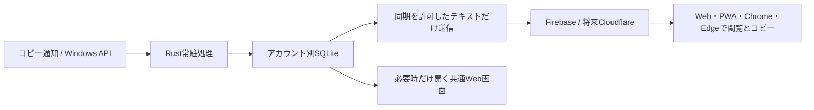

# Windows版 実装計画 — 確認待ち

作成日: 2026-10-24 / 元になるWeb版: 1.3.76

**この文書は計画。Windowsアプリ、常駐処理、クリップボード収集、新しい履歴画面はまだ実装していない。確認を受けてから段階0に着手する。**

## 1. 採用したい構成

推奨は **Tauri 2＋Rustの常駐処理＋WindowsのWebView2＋SQLite**。現在のHTML/CSS/JavaScriptの画面を共有し、Windows固有処理だけをRustへ分ける。Web/PWA/Chrome/Edgeを別々の画面実装にしない。

| 方法 | 今回の適性 | 判断 |
|---|---|---|
| Tauri 2＋WebView2 | 既存Vite画面を再利用し、クリップボード・DB・同期をUIから独立させられる | 推奨。RustとC++ビルド環境の準備が必要 |
| C#/.NET＋WebView2 | Windows APIを扱いやすい。Windows限定なら有力 | Tauriの検証で問題が出た場合の候補。別のUIラッパーの維持が必要 |
| Electron | 既存JSの移植は容易 | 今回は常駐メモリの目標と比較して優先度を下げる |
| PWAのみ | 現行画面をそのまま利用できる | ブラウザ外の継続的なクリップボード記録を担う構成にはしない |

TauriのWebViewはWindowsではWebView2を使う。[Tauriのプロセスモデル](https://v2.tauri.app/concept/process-model/)、[WebViewの仕様](https://github.com/tauri-apps/tauri-docs/blob/v2/src/content/docs/reference/webview-versions.md)を根拠にした設計判断。**Tauriに変えれば自動的に省メモリになるとは扱わず、実測して採否を確定する。** このPCのPATHではdotnetは見つかったが、rustc/cargoは未検出。今回は開発環境を追加していない。

## 2. 普段の動作と省メモリ方針

- 起動時は通常のFlickMemoのメモ画面。追加タブに「クリップボード履歴」「端末間共有」を配置する。
- 閉じるボタンでは編集内容を永続化してからWebViewのウィンドウを破棄し、トレイのネイティブ処理だけを残す。単に隠してWebViewの全メモリを常駐させる設計は採らない。
- トレイの「開く」や設定したショートカットでWebViewを再生成する。未送信のメモ、編集中のメモID、検索条件等を復元する。
- ファイル転送中は閉じる前に「転送を続ける／切断して閉じる」を表示する。現行P2P転送をWebView破棄で無言で切断しない。
- トレイには「開く」「記録を一時停止」「同期状態」「終了」。自動起動は任意設定。Win＋Vはそのまま残し、奪わない。
- 常駐中にHTML、Prism、ZIP、画像デコーダーを動かさない。クリップボードを定期ポーリングしない。履歴画面は50件ずつ読み、本文を全件常駐させない。
- WebView破棄後のプロセス解放を測定し、ランタイムが長時間残る場合はUIを別プロセスとして終了できる構成を再評価する。

## 3. クリップボード履歴の仕様

### 新しくコピーされる内容

Win32の `AddClipboardFormatListener` と `WM_CLIPBOARDUPDATE` を受けるネイティブの通知用ウィンドウを作る。[Microsoftの推奨する変更通知](https://learn.microsoft.com/en-us/windows/win32/dataxchg/using-the-clipboard)に従い、イベントが来たときだけ処理する。

処理順: 変更通知 → 記録ON／画面ロック／除外設定の確認 → 形式判定 → サイズ確認 → テキスト取得 → 重複確認 → ローカル保存 → 必要なら同期キューへ追加。

| 項目 | 初期仕様 |
|---|---|
| 記録の開始 | 初回はOFF。「記録を開始」で明示的に有効化 |
| クラウド同期 | 記録とは別スイッチ。初回はOFF。送信対象と保存先を説明して有効化 |
| テキスト | Unicodeのプレーンテキスト。改行を保持。HTMLは実行しない |
| 1件の上限 | UTF-8で64KiB。超えた場合は保存しない理由を表示。無言で切り捨てない |
| 保持量 | 7日／1000件／本文合計16MiBのうち先に到達した条件で未固定の古い項目を整理 |
| ピン留め | 最大100件。固定分も合計容量の枠に含める |
| 重複 | 連続して同じ内容なら同一履歴の時刻・回数を更新。異なる端末の履歴は出所を保持 |
| コピーのループ | 自アプリによる書込みマーカー、シーケンス番号、内容照合で再取り込みを防ぐ |
| 取得の失敗 | クリップボードの一時ロックは回数を制限して再試行。UIを止めず、無制限にスレッドを増やさない |
| 画像 | **「画像の保存・同期はまだ実装されていません」**というカードのみ。画像本体を読み込んで保存／アップロードしない |
| その他の形式 | ファイル一覧、HTML、リッチテキスト等を自動保存しない。文字が取得できる場合だけテキストとして扱う |

画像履歴の未実装表示は新しいクリップボード機能に対するもの。既存のP2P画像ファイル送信まで無効にはしない。

### Win＋Vに既にある履歴

`Clipboard.GetHistoryItemsAsync` による**初回／手動の取り込み**を別機能にする。既存履歴の文字と、以後の変更通知の文字は同じ保存形式にする。

Windows側の履歴が無効なら「Windowsの履歴は無効です。今後コピーする内容の記録は利用できます」、アクセスを拒否された場合は「既存履歴を取得できません」と表示する。Windowsの設定を勝手に変更しない。APIにはSuccess／AccessDenied／ClipboardHistoryDisabledがあるため、全PCで既存履歴を必ず取得できるとは約束しない。[取得API](https://learn.microsoft.com/en-us/uwp/api/windows.applicationmodel.datatransfer.clipboard.gethistoryitemsasync)、[戻り値](https://learn.microsoft.com/en-us/uwp/api/windows.applicationmodel.datatransfer.clipboardhistoryitemsresultstatus)。

アプリ停止中の全コピーを後から完全復元できる機能とは説明しない。Win＋V側で既に消えた履歴は取り戻せない。

## 4. 履歴画面と小さな便利機能

- 日付ごとにまとめた履歴カード。文字のプレビュー、コピー元の端末、時刻、同期状態、コピー回数を表示。
- 検索、端末・日付・種類での絞り込み、ピン留め、1クリックコピー、選択した履歴をメモに保存。
- コピー後の短い通知、履歴を開くショートカット、重複をまとめる設定。
- 「10分停止」「次回再開まで停止」、除外アプリ、容量表示、自動整理、履歴の個別削除。
- 「ローカルのみ」「同期待ち」「同期済み」「要ログイン」を区別。オフラインをエラー連打で知らせない。
- ショートカットは変更可能。OSや他アプリと競合した場合は登録失敗を示し、Win＋Vを置き換えない。
- 大量削除は件数を示して確認。PCの履歴を消す操作と、他端末にも同期する削除を区別する。
- 画像カードには未実装と明記し、押せないプレビュー／ダウンロードボタンを出さない。

## 5. 他端末への同期と将来のCloudflare移行

最初は現行のGoogle/Firebaseアカウントを利用し、メモとは別の履歴領域を作る。ゲスト履歴はそのPC内だけに保存する。Windowsで記録し、ログインしたWeb/PWA/Chrome/Edge側の同じ履歴タブで閲覧・コピーできるようにする。

新しい同期処理は `HistoryRepository` と `HistorySyncAdapter` の境界を作る。画面やクリップボード処理がFirebaseのパスへ直接書き込まない。

| データ | 当初 | 将来のCloudflare案 |
|---|---|---|
| テキスト、時刻、端末、同期情報 | ローカルSQLite＋Firebaseのアカウント別領域 | Workers経由のD1 |
| 画像の実体 | 未実装、保存しない | R2の非公開オブジェクト |
| 画像のメタ情報 | 未実装カードのみ | D1にR2の参照とサイズ等 |
| 選択中テキストのリアルタイム配信 | Firebaseの短命データ領域 | Durable Objects等を別途評価。D1へ毎フレーム保存しない |
| ログイン | Google/Firebase | 初期は認証を維持し、Workers側でFirebase IDトークンを検証する案 |

履歴レコード案: `id, schemaVersion, ownerUid, originDeviceId, kind(text/image_placeholder), text, createdAt, updatedAt, expiresAt, pinned, deletedAt, revision`。ローカルには `syncState` と送信キューを別に持つ。画像用フィールドは予約しても、画像バイナリやbase64をD1/Firebaseのテキストへ埋め込まない。

- UUIDによる再送の冪等性、端末ごとのカーソル、保留削除、オフライン再送を扱う。時計がずれたPCでも順序を壊さないよう、同期側の時刻・改訂情報を使う。
- 同期は差分と小さなバッチ。履歴全件を毎回読み込まない。再接続は待機時間を延ばし、上限到達時はローカル保存を維持する。
- 削除は墓標として伝播し、古いオフライン端末からの復活を防ぐ。墓標の保持期間を超えた端末は全体の照合をやり直す。
- アカウントAのキューをBの認証で送らない。ログアウト時に送信を停止し、ローカルのアカウント別領域は混ぜない。
- Workersは署名・issuer・audience・期限を検証したUIDだけでアクセス先を決める。クライアントが指定したownerUidを信用しない。D1/R2の鍵をアプリに配布しない。

無料枠は2026-10-24に公式資料を確認した。D1 Freeは単一DB500MB・アカウント全体5GB、1日500万行の読込み／10万行の書込み。Workers Freeは1日10万リクエスト等の制約がある。R2 Standardの無料枠は月10GB-monthと操作回数枠。**無制限無料ではない**ため、使用量を計測し、上限時は同期を待機させる。Cloudflare移行、R2の有効化や課金設定は今回行わない。[D1上限](https://developers.cloudflare.com/d1/platform/limits/)、[D1料金](https://developers.cloudflare.com/d1/platform/pricing/)、[Workers上限](https://developers.cloudflare.com/workers/platform/limits/)、[R2料金](https://developers.cloudflare.com/r2/pricing/)。

## 6. 選択した文字のリアルタイム共有

これは履歴とは別の、初期OFFの明示的な共有モードにする。

1. 最初はChrome/Edge拡張の「選択を共有」を操作して送る方式を実装する。同じGoogleアカウントの許可した端末だけが受信する。
2. 次に、ユーザーが許可したサイトだけ、選択変更時の自動送信を追加する。パスワード欄、機微な入力欄、除外サイトは対象外。必要なホスト権限は任意許可にする。
3. Windowsのブラウザ外アプリは、UI Automationが選択テキストを公開しているアプリから対応する。全アプリ共通で取得できるとは扱わない。非対応なら明示ボタン／コピー履歴で代替する。

変化時だけ最大毎秒1回、最大4KiB。超えた場合は短縮を明示する。未選択、共有OFF、ロック、ログアウト、接続終了で消す。受信側でも有効期限30秒を検証し、切断後の古い選択を表示し続けない。選択内容は既定では履歴に永続保存せず、「メモに保存」を押した場合だけ残す。受信側のクリップボードは自動で書き換えず、コピーを押したときに書く。

## 7. 認証・プライバシー・権限

- Windows版のGoogleログインはシステムブラウザで行う。WebView内のGoogleログインを前提にしない。デスクトップ向けOAuth＋PKCE＋短命のstate、ループバックのコールバックを候補として、段階0でFirebaseと組み合わせて実証する。[Googleのデスクトップ向けOAuth](https://developers.google.com/identity/protocols/oauth2/native-app)。
- 同じGoogle認証結果からUI用と常駐処理用のFirebaseセッションを確立できるか確認し、双方のUID一致を検証する。専用OAuthクライアントの登録等が必要なら、その設定内容を示してから行う。秘密のサーバー鍵を配布物へ入れない。
- 常駐側の更新トークンとローカル暗号鍵はWindowsのユーザーに結び付けた保護領域へ保存する。ログ・URL・クリップボードへ出さない。
- ローカル本文はアカウント別の鍵で暗号化してSQLiteへ保存する案とする。鍵をWindows DPAPIで保護し、検索時は必要な範囲だけ復号する。平文の全文検索索引を不用意に別保存しない。
- 初期のクラウド同期は現行メモと同様のTLS＋UID単位の認可を基本とする。**履歴のE2EEは別の鍵配布設計を行わない限り保証しない。** 有効化画面で、送信されるデータと保護範囲を明記する。必要なら端末ペアリング鍵によるE2EEを先行課題へ繰り上げる。
- Windowsの除外用クリップボード形式を尊重する。`ExcludeClipboardContentFromMonitorProcessing` や履歴／クラウドへの保存を禁止する形式は自動記録しない。[Microsoftの形式仕様](https://learn.microsoft.com/en-us/windows/win32/dataxchg/clipboard-formats)。
- 形式の指定がない秘密情報まで完全に判別できるわけではない。パスワード管理アプリ等の除外、常時見える記録状態、即時停止を用意し、「パスワードを絶対に保存しない」と断言しない。
- 常駐はユーザーセッション内。管理者権限やWindowsサービス化は初期版で要求しない。画面ロック中は記録・選択共有を停止する。
- WebViewは同梱したフロントエンドだけを表示し、任意の外部ページにネイティブAPIを渡さない。公開するコマンドを列挙し、引数・サイズ・UIDをネイティブ側でも検証する。[Tauri Capabilities](https://v2.tauri.app/security/capabilities/)。

## 8. 実装の順序と各段階の完了条件

| 段階 | 作る／確認する内容 | 完了条件 |
|---|---|---|
| 0: 現行版安定化と技術検証 | 監査レポートの公開前項目、旧キャッシュ復旧方針、実Google認証、WebViewの生成・解放、Windows履歴API、必要な開発環境を確認 | Chrome/Edgeの実認証が通り、常駐の可否とメモリ実測を記録できる。未解決のまま機能を積み上げない |
| 1: Windowsの器 | Tauriプロジェクト、共通メモ画面、トレイ、単一起動、閉じる／再表示、終了 | 20回の開閉でメモが失われず、プロセス・イベントハンドラーが増え続けない |
| 2: ローカル履歴 | 変更通知、明示的ON/OFF、SQLite、暗号鍵保護、テキスト記録、画像未実装カード、Win＋V手動取込み | Unicode、改行、重複、画像、巨大文字、取得拒否、画面ロック、アプリ終了後の復元を検証 |
| 3: 履歴UI | 検索、絞り込み、50件表示、ピン留め、コピー、メモ化、除外、保持期限 | 大量履歴でも全文常駐せず、ユーザー操作で正しい項目をコピー／削除できる |
| 4: 他端末同期 | Firebaseアダプター、限定クエリ、履歴の共通UI、再送・削除・アカウント切替 | Windows→Web/PWA/Chrome/Edgeで閲覧とコピー。通信断・期限切れ・A/B切替・削除の再送で混線や復活がない |
| 5: 選択共有 | 明示送信→許可サイトの自動送信→対応Windowsアプリ、期限・停止・対象端末 | 共有OFF／未許可サイト／パスワード欄は送らず、切断後30秒以内に受信表示が失効する |
| 6: 配布品質 | インストーラー、任意の自動起動、更新署名、ログの秘匿、性能試験、Web等の回帰確認 | クリーンなWindows 11環境で導入・更新・アンインストール、24時間の待機試験を実施 |
| 7: 将来の別フェーズ | Cloudflare移行、R2画像保存、暗号化した画像、必要ならOCR | 別途仕様を確認して着手。今回の初期Windows版には含めない |

段階ごとに実機で結果を報告し、テストが落ちている状態で次へ進まない。開発は既存のWebコードを段階的にモジュール化し、全面書き換えは行わない。

## 9. 追加／分離するファイルの目安

- `src-tauri/src/clipboard.rs`: Windows通知・形式判定・上限・除外・自アプリのループ抑止。
- `src-tauri/src/history_store.rs`: アカウント別SQLite、保持期限、暗号化、ページ単位の検索。
- `src-tauri/src/history_sync.rs`: UIDに固定した送信キュー、再試行、ログアウト停止。
- `src-tauri/src/auth.rs`, `tray.rs`, `window_lifecycle.rs`: 認証、常駐メニュー、表示と終了の責任を分離。
- `platform/desktop.js`: 許可したネイティブ機能だけを呼ぶ橋。Web版でWindows用コードを読み込まない。
- `history/`: 共通の履歴UI、保存先インターフェース、Firebaseアダプター、画像未実装カード。
- `selection/`: 一時的な選択共有。永続履歴と別の状態管理。
- `tests/`, ネイティブ側テスト、DBルール試験: 既存30件を維持し、新しい境界と異常系を追加。

## 10. 性能・異常系の受入基準

以下は**未実測の目標**。段階0で基準機と計測方法を決め、達成できなければ原因と代案を報告する。

| 指標 | 初期目標 |
|---|---|
| UIを閉じた待機時 | ネイティブ側Private Bytes 30MiB程度以下を目指す。自アプリのWebView2子プロセスも含めて別計測 |
| 待機CPU | 60秒平均0.1%程度以下を目指す。通知のない時に定期的なクリップボード読み取りをしない |
| 表示時 | 共通UI＋自アプリ分WebView2の合計Private Bytesを測定。常駐だけの値と混同しない |
| 履歴の負荷 | 1000件・各4KiBの標準データ、および上限64KiBのデータでメモリ・検索・スクロールを測る |
| コピーから保存 | 標準テキストで95%が250ms以内を目標。クラウド到達時間とは分ける |
| 画面の再表示 | キャッシュありで95%が1秒程度以内を目標。WebView破棄とのトレードオフを実測 |
| 漏れの確認 | 開閉20回、記録1000回、24時間待機後にメモリ・購読・DB接続が増え続けない |

必須の異常系: オフライン、スリープ復帰、認証期限切れ、二重起動、アカウント切替、ディスク容量不足、DB移行失敗、取得元アプリの応答停止、クリップボード競合、ネットワーク切断、同時削除、時計ずれ、無料枠到達、WebViewクラッシュ、更新失敗。テスト用データと環境で確認し、実ユーザーの履歴を使った負荷試験は行わない。

## 確認してほしい範囲

この計画への承認で始めるのは段階0から。初期版は「低メモリの常駐」「文字履歴」「他端末閲覧」「画像は未実装表示」を優先する。Cloudflareへの移行や画像保存は後の別フェーズとする。選択の自動共有は、明示送信が安定してから段階的に追加する。
